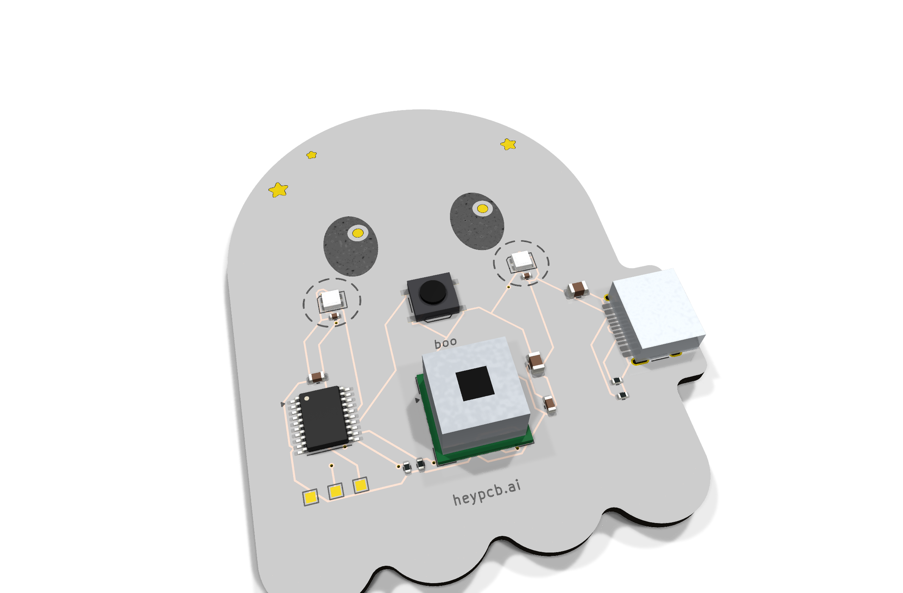
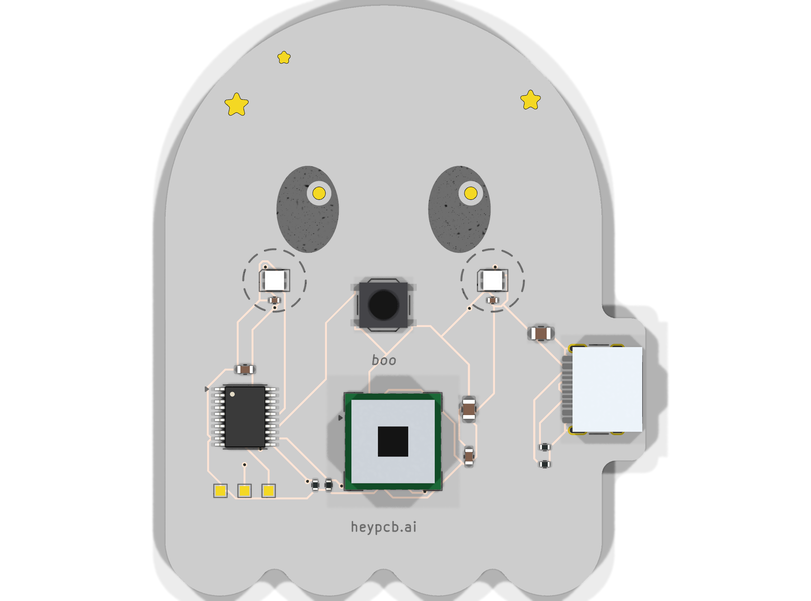
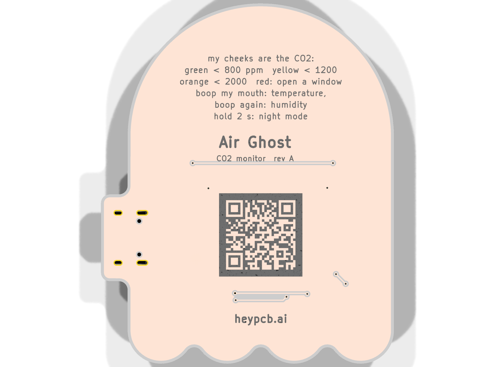

# Air Ghost

**A little ghost that blushes red when your room needs fresh air.**

Air Ghost is a desk CO2 monitor shaped like a ghost, on USB-C. A Sensirion SCD40 measures real CO2 (photoacoustic NDIR, not a VOC estimate) plus temperature and humidity every 5 s, and a CH32V003 turns the reading into the colour of the ghost's two WS2812 cheeks: green when the air is fresh, through yellow and orange to a pulsing red at 2000 ppm. Its round "O" mouth is a button: boop it for temperature and humidity colours, hold it for night mode.

| Layers | Size | Parts | Nets | Connections routed | Vias | ERC errors | DRC errors / unconnected / parity | BOM @100 |
|---|---|---|---|---|---|---|---|---|
| 2 | 50.7 x 62.3 mm | 16 (+3 pads) | 12 | 50 -> 0 open | 10 | 0 | 0 / 0 / 0 | $15.66 |

**Not fabricated, assembled or powered yet.** Every number on this page is measured by KiCad 10.0.6 on
the files in this repository ([`report.json`](report.json), [`measured.json`](measured.json)) or read
from the live JLC/LCSC catalogue ([`bom_cost.json`](bom_cost.json)).

| | |
|---|---|
| Spec, power budget, BOM | [`SPEC.md`](SPEC.md) |
| Store copy | [`STORE_COPY.md`](STORE_COPY.md) |
| KiCad 10 project | [`kicad/`](kicad/) |
| Gerbers, drill, BOM, CPL, STEP, schematic PDF | [`fab/`](fab/) |
| Firmware | [`firmware/`](firmware/) |
| Renders | [front](media/top.png), [back](media/bottom.png), [hero](media/hero.png), [Circuit World thumbnail](media/circuit-world.png) |
| Brief and generator | [`design/`](design/) |

 

## What's on it

- **Sensor:** Sensirion SCD40-D-R2 (CO2 400-2000 ppm, temperature, humidity) at I2C 0x62, from 5 V, with 10 uF + 100 nF beside it and 10k pull-ups.
- **MCU:** CH32V003F4P6 from 5 V; bit-banged I2C with CRC checks (ch32fun's static_i2c.h).
- **Cheeks:** two WS2812C-2020 RGB LEDs, each with its 100 nF, chained from PC6.
- **Mouth:** a TS-1187A button; its round plunger is the ghost's "O".
- **Power:** USB-C with 5.1 kOhm CC pull-downs, about 25 mA (SPEC.md).
- **BOM:** $15.66 at 100, of which the SCD40 is $14.82: the collection's one deliberate exception to its $8 target (SPEC.md says why).

## Finish

White solder mask, Black silkscreen, ENIG copper finish, 1.6 mm FR4, top-side SMT assembly (J1: an SMD part whose shell legs go through plated holes, soldered on the same SMT line).
The gold art is bare copper under a mask opening (ENIG), drawn with its own keep-out so no track runs
under it. The QR code on the back opens [https://heypcb.ai/world/b/0fc87b5d15f5](https://heypcb.ai/world/b/0fc87b5d15f5).

## How it was made

Designed with the HeyPCB method on KiCad 10.0.6, headless, by the `heypcb-kicad` pipeline: a written
brief composed from reusable circuit blocks, every pin from KiCad's own symbol library, every part bound
to an LCSC number from a dated catalogue read, then ERC, a netlist round trip, locked placement,
Freerouting 2.4.1, pours, silkscreen and board art, DRC with schematic parity, DFM and a fab gate,
each stage gated by a measurement. `design/make_brief.py` regenerates the brief (outline, part
locks and art) from code.

Part of the [heypcb.ai merch collection](https://github.com/HeyPCB/merch).

## License

Hardware: [CERN-OHL-S v2](LICENSE). Firmware: MIT (see [`firmware/LICENSE`](firmware/LICENSE)). KiCad's symbol, footprint and 3D
libraries used in the design are CC-BY-SA 4.0 with the KiCad library exception.
